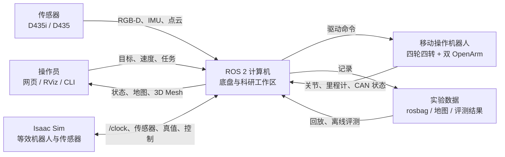
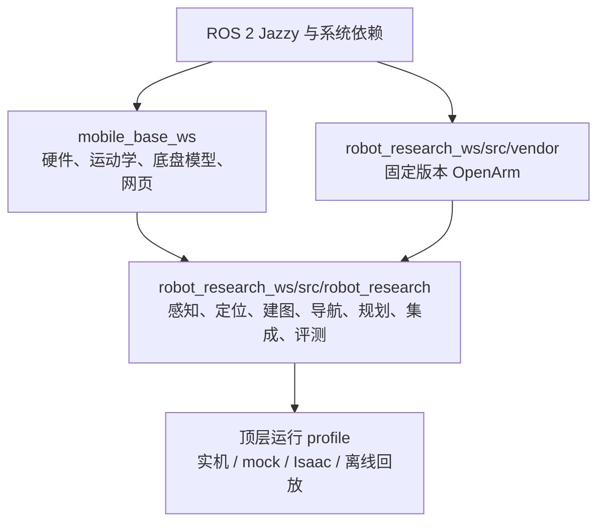
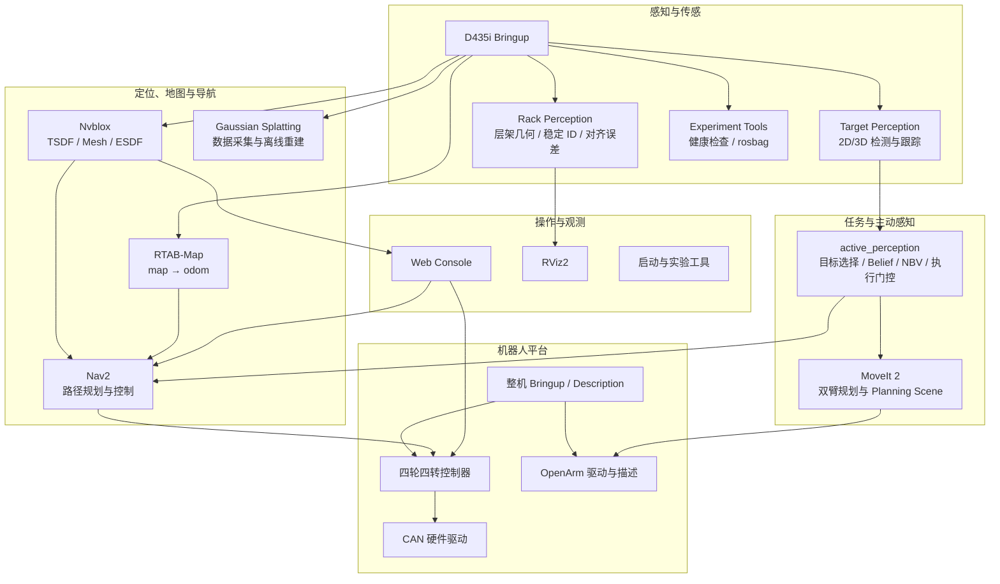
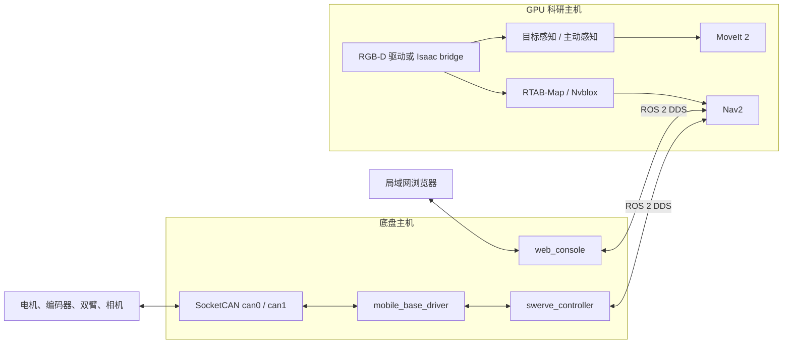

# 移动操作机器人架构导航

这组文档是工程的长期架构入口。它回答四个问题：系统由什么组成、数据如何流动、每个包负责
什么、修改后需要同步更新哪里。实验结论和阶段性完成度仍记录在上一级实施计划中，不塞进
架构图，避免架构说明随实验日志膨胀。

## 阅读路径

1. [工程交接文档](../HANDOFF.md)：整体能力、启动方式、限制与下一步。
2. 本页：系统边界、分层和部署关系。
3. [运行时数据流](RUNTIME_FLOWS.md)：建图、导航、网页、三维重建和主动感知的时序。
4. [包目录](PACKAGE_CATALOG.md)：每个 ROS 包的职责、入口、关键接口和边界。
5. [维护规则](MAINTENANCE.md)：新增包、话题、启动 profile 时必须更新的内容及自动检查。
6. [实施状态](../ARCHITECTURE.md)：已经完成、尚未完成及验证证据。

## 系统上下文



## 工作空间和依赖方向

依赖只允许自下而上。底盘工作区不能反向依赖科研算法；vendor 快照不能被集成代码直接修改。



标准环境加载顺序：

```bash
source /opt/ros/jazzy/setup.bash
source /media/scc/Windows_D/AAA/mobile_base_ws/install/setup.bash
source /media/scc/Windows_D/AAA/robot_research_ws/install/setup.bash
```

## 功能分层



实线表示允许的主要运行时依赖。Nvblox 是可选层：默认导航仍以 RTAB-Map 静态地图和原始
点云安全链为基线。Gaussian Splatting 是采集/离线重建支线，不进入底盘闭环控制。

## TF 所有权

TF 必须只有一个所有者，禁止为“让可视化先亮起来”而重复发布。

| 变换 | 所有者 | 说明 |
|---|---|---|
| `map -> odom` | RTAB-Map 定位/建图 | 全局校正；Nvblox 不发布 |
| `odom -> base_link` | 底盘控制器或仿真底盘 | 连续局部里程计 |
| `base_link -> robot links` | `robot_state_publisher` | 来自统一 URDF 与关节状态 |
| `base_link -> nav_camera_*` | 整机描述 | 真机外参需标定；仿真使用 nominal 光学帧 |
| `world -> odom` | 指定仿真/测试 profile | 普通实机导航不应伪造 |
| `odom -> sim_world` | 棚架 Isaac 仿真 profile | 真值场景坐标；避免与 RTAB-Map 的 `map -> odom` 争夺 odom 父节点，不是实机定位来源 |

## 部署视图



单机部署时 HostA 与 HostB 合并；双机部署要求相同 ROS domain、时间同步和可互通 DDS 网络。

## 安全边界

- 网页按钮、Nav2 和主动感知执行器都不是实体急停。
- `collision_monitor`、控制命令超时、驱动错误处理和人工断电构成不同层次的保护，不能互相替代。
- 主动感知自动执行默认关闭，需要启动参数允许和运行时服务二次确认。
- Nvblox/RTAB-Map/感知失效不得绕过原始传感器安全链。
- `mobile_base_ws` 的硬件参数与机械限位变更必须先架空轮组验证。

## 工程目录

```text
AAA/
├── mobile_base_ws/                 # 可独立运行的底盘工作区
│   ├── src/                        # 5 个底盘 ROS 包
│   ├── docs/                       # 实车操作、部署与底盘架构
│   └── deploy/                     # systemd/环境示例
├── robot_research_ws/              # 顶层科研 overlay
│   ├── src/robot_research/         # sensing/localization/mapping/navigation/...
│   ├── src/vendor/                 # 固定版本 OpenArm 上游源码
│   ├── tools/                      # Isaac 与离线辅助工具
│   ├── docs/                       # 架构、计划与验收记录
│   ├── maps/ datasets/ results/    # 地图、数据集与实验结果
│   └── assets/                     # Isaac/整机资产
└── chassis_4wis/                   # 原始底盘描述资产；不是运行时 overlay
```

`build/`、`install/`、`log/` 是生成物，不作为架构事实来源。
