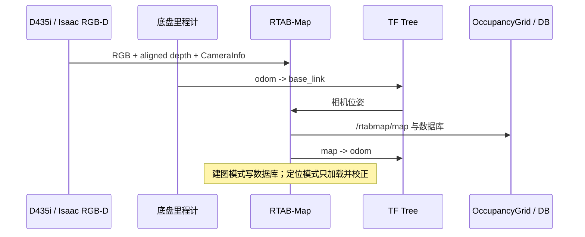
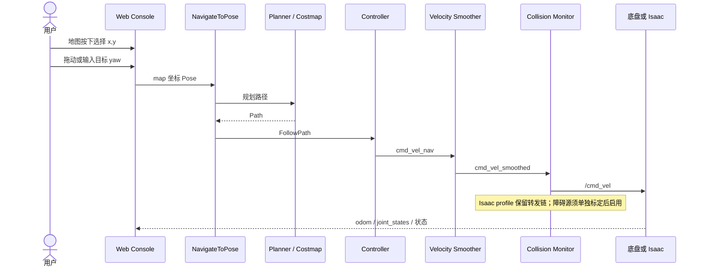
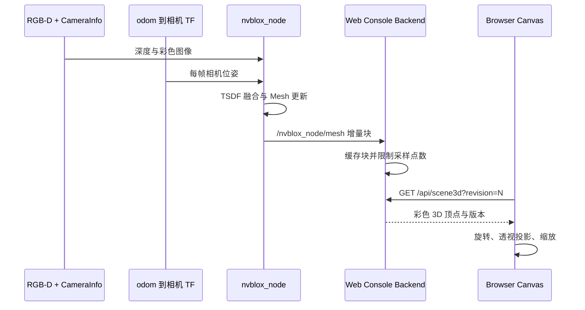
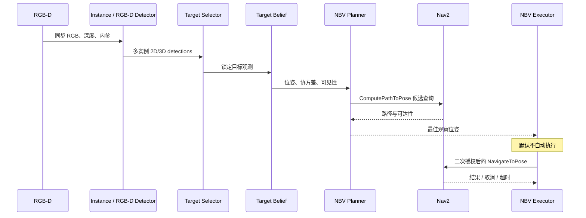
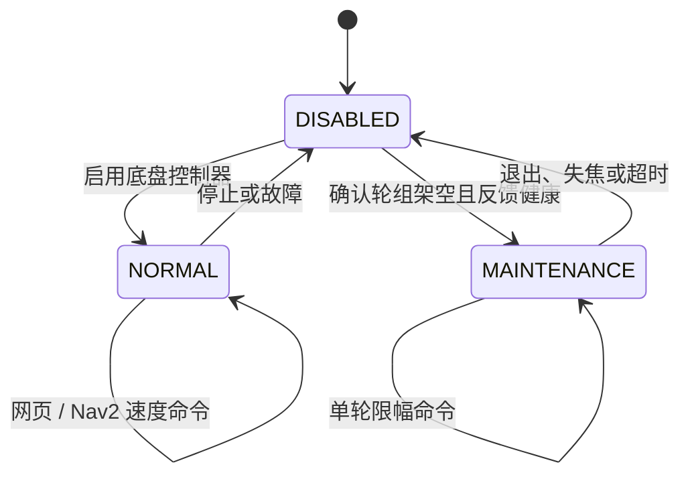

# 运行时数据流

本页描述“启动后发生什么”。接口名以当前默认 profile 为准；具体参数仍以各包 YAML 和
launch 文件为事实来源。

## 建图与定位

## 网页点击导航

位置到达容差与障碍膨胀是两件事：前者决定离目标多近算完成，后者决定规划时离障碍多远。

## Nvblox 三维环境到网页

网页只做显示，不反向影响 Nvblox 或 Nav2。没有 RGB-D、TF 或 Mesh 时显示“等待 Nvblox”，
不会把二维栅格伪装成三维地图。

## 目标感知与主动视角

## 控制模式状态机

Isaac 直控 profile 不进入硬件维护模式。

## 典型启动组合

| 场景 | 顶层入口 | 包含 | 明确不包含 |
|---|---|---|---|
| 实车底盘 | `mobile_base_bringup robot.launch.py` | CAN、ros2_control、描述、可选网页 | 感知与导航算法 |
| 底盘 mock | `mobile_base_bringup mock.launch.py` | mock hardware、控制器、描述 | CAN 实机 |
| 实机导航 | `mobile_navigation_bringup navigation.launch.py` | 相机、RTAB 定位、Nav2、安全链 | Nvblox 默认关闭 |
| Isaac 导航 | `mobile_base_sim_navigation.launch.py` | 描述、RTAB 定位、Nav2、网页；可选 Nvblox | Isaac 进程本体、CAN 实机 |
| Nvblox | `nvblox_bringup mapping.launch.py` | TSDF/Mesh/ESDF | 定位所有权 |
| 感知最小链 | `sim_perception.launch.py` | Isaac RGB-D、描述、目标感知 | MoveIt、Nav2 |
| 主动感知 | `sim_active_perception.launch.py` | 感知、Belief、NBV、可选执行 | 默认自动运动 |
| 双臂规划 | `mobile_manipulator_moveit_config demo.launch.py` | MoveIt、Planning Scene、控制器 | 自主导航 |
